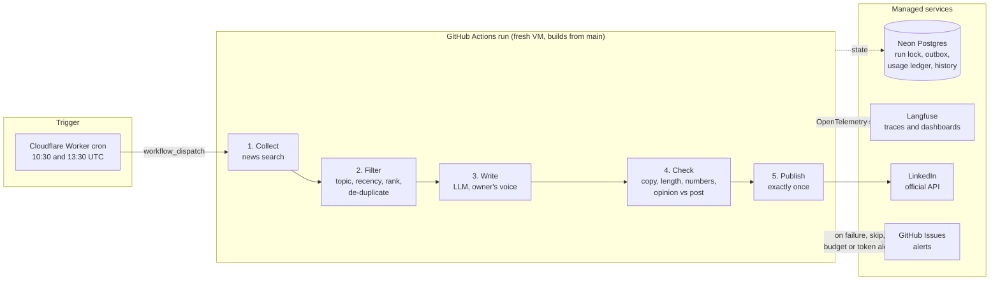

# Shipping an Autonomous AI Workflow to Production: A Field Guide

**How a self-running LinkedIn content system finds the day's AI news, writes a post, checks it and publishes it every day, with no servers, a $10/month hard budget enforced in code, and full observability.**

This guide documents the strategies and architecture behind a system that has run in production since October 2026. It describes *what* was built and *why*, with the measured results and the incidents that shaped it. Source code, prompts and credentials are intentionally not included.

---

## At a glance

| | |
|---|---|
| **What it does** | Every day: finds AI news, ranks and de-duplicates it, writes a LinkedIn post in the owner's voice, checks it, and publishes it exactly once |
| **Human in the loop** | None day to day. The owner sets it up, tunes the voice, and renews the LinkedIn token every 60 days (a LinkedIn requirement) |
| **Infrastructure** | Serverless: Cloudflare Workers cron, GitHub Actions, Neon serverless Postgres, Langfuse (OpenTelemetry) |
| **Budget** | $10/month and $1/day hard caps, checked before every model call, failing closed |
| **Actual spend** | $0.65 billed in the first month to date (as of 2026-10-12), mostly from a quality-judge experiment later switched off |
| **Quality engineering** | About 750 automated tests; a seeded fact-check eval harness (20 planted errors, 5 clean controls, 95% catch-rate target; real model recordings pending) |
| **Safety and governance** | Shadow mode by default, a kill switch, idempotent publishing, prompt-injection escaping, secret scanning, decision records and a full audit trail |

## Architecture

## The guide

| # | Chapter | What you'll find |
|---|---|---|
| 1 | [System overview](docs/01-system-overview.md) | Goals, the five stages, autonomous vs agentic, design principles |
| 2 | [Content strategy](docs/02-content-strategy.md) | Sourcing, ranking, de-duplication, voice, integrity rules |
| 3 | [Reliability engineering](docs/03-reliability.md) | Run lock, idempotent publishing, retries, fallbacks, failing safe |
| 4 | [Observability](docs/04-observability.md) | Per-tool tracing, dashboards as code, alerts with de-duplication |
| 5 | [Cost engineering](docs/05-cost-engineering.md) | Hard budget caps, model choices, billing collection, measured spend |
| 6 | [Deployment](docs/06-deployment.md) | Serverless, main is production, exact-time trigger, shadow mode, kill switch |
| 7 | [Security and governance](docs/07-security.md) | Secrets, prompt injection, decision records, audit trail, least privilege, platform policy |
| 8 | [Evaluation](docs/08-evaluation.md) | Seeded fact-check eval, record-and-replay in CI, golden post |
| 9 | [Results and lessons learned](docs/09-results-and-lessons.md) | Measured numbers and the incidents that shaped the design |
| 10 | [Future work: the agentic version](docs/10-agentic-roadmap.md) | Scouts, curator, writer, critic, semantic memory |
| — | [References](docs/references.md) | Platform documentation and sources |

## Five ideas worth taking away

1. **Autonomy comes from engineering, not prompting.** The model writes the post; the reliability, cost and safety layers around it are what let it run unattended.
2. **Fail safe, not loud.** A missing token, an expired token or an unset flag falls back to *shadow* (draft only), never to an accidental post.
3. **Measure the provider, not the documentation.** A search API asked for 30 results silently returned 2; a reasoning model spent its whole token budget thinking. Every stage checks what it actually received.
4. **Strictness has a cost.** A strict LLM judge caught real errors but blocked every post for a week. A gate that never lets anything through is also a failure.
5. **Budgets belong in code.** A spending cap checked before each call, failing closed, beats a dashboard someone has to watch.

---

*Author: [TechNaom](https://github.com/TechNaom). Numbers are measured and dated; targets and plans are labelled as such.*
