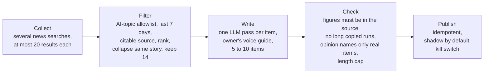

# 1. System overview

**The system publishes one LinkedIn post a day with no human in the loop. A fixed, five-stage workflow does the work, and an engineering layer around it handles reliability, cost, safety and observability.**

## Goals

| Goal | Meaning | Measured by |
|---|---|---|
| Consistency | A post goes out every day without manual work | Days published vs days scheduled |
| Credibility | Every fact traces to a source; no repeated or stale stories | Unsupported claims; repeats per week |
| Voice | Posts read as the owner, not as generic AI text | Owner review |
| Cost | Running cost stays near zero | Cost per run, monthly bill |
| Safety | The system can never double-post, overspend or post by accident | Guard rails tested in CI |

## The five stages

| Stage | Decides | How |
|---|---|---|
| Collect | What news exists today | A news-search API, several queries, capped at 20 results per query (see [lessons](09-results-and-lessons.md)) |
| Filter | What is worth posting | Deterministic rules: on-topic, recent, citable, ranked, near-duplicates collapsed, already-seen items dropped |
| Write | How it reads | An open-weight LLM writes each item from its own source, following a versioned voice guide |
| Check | Whether it is safe to post | Code-only checks in the default mode; an optional LLM judge in "full" mode |
| Publish | Whether and where it goes out | Official LinkedIn API, exactly once per day |

## Autonomous, not (yet) agentic

The terms are often confused, and the difference shapes the design.

| | Workflow (this system today) | Agent (the planned next version) |
|---|---|---|
| Who decides the next step | Code | The model |
| Does the model choose tools? | No | Yes |
| Does it loop until satisfied? | No, one pass plus code checks | Yes, within limits |
| Where the model uses judgment | Inside each step: what to include, how to phrase it | Inside each step *and* between steps |

The system is **autonomous** because it runs end to end and recovers from failures by itself. It is a **workflow** because code controls the flow. That was a deliberate choice: the daily path is predictable, so a workflow is cheaper, faster and easier to debug. The agentic version is being built and will be compared against this one in shadow mode ([chapter 10](10-agentic-roadmap.md)).

## Design principles

1. **Safe by default.** Every uncertain state resolves to "don't publish": a missing token, an expired token, an unset flag, unreadable spend.
2. **Deterministic where possible, model where necessary.** Ranking, de-duplication, length and copy checks are plain code, so they are free, fast and testable.
3. **Every external call is observable.** Each call to a search API, model, database or LinkedIn produces a span and a structured log line.
4. **Nothing is deleted to change behaviour.** Modes are switched by configuration, so any decision can be reversed with one variable.
5. **No servers to own.** Everything runs on managed, on-demand services.
