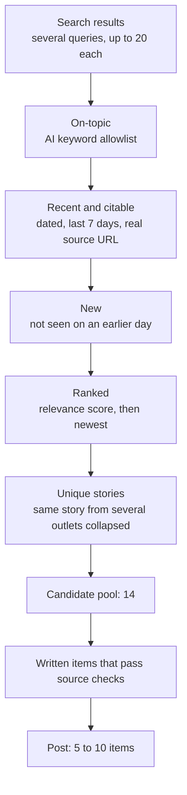

# 2. Content strategy

**The content strategy is a funnel: cast a wide net, filter hard with cheap deterministic rules, then spend model tokens only on the few items that survive.**

## The funnel

## Sourcing

- A news-focused search API, queried with several AI-industry queries.
- **Only dated news articles count.** Undated pages were how evergreen round-ups once slipped in as "today's news", so an item without a date is dropped.
- Results are capped at 20 per query. Asking for more made the API silently return far fewer.

## Ranking and de-duplication

| Layer | What it catches | Method |
|---|---|---|
| Across days | Stories already covered | A hash of every item ever seen, stored in Postgres |
| Within a day | The same story from different outlets | Title similarity; above 75% counts as a repeat |
| Ordering | What matters most | Relevance score, then recency, then title, so ties break the same way every run |

Known gaps (see [chapter 10](10-agentic-roadmap.md)): reworded headlines can pass the title-similarity check, and one roundup article covering several launches becomes a single item.

## Voice

- A **versioned voice guide** is distilled from the owner's own past posts (45 distinct posts). A rule was kept only if it held in at least a third of them.
- Every draft records which voice-guide version produced it, so old drafts stay attributable after the guide changes.
- Structure: a one-line hook naming the day's most notable item, then a numbered list of 5 to 10 items, each with concrete specifics (numbers as digits, named products and companies) and its source link, then a short opinion and a fixed sign-off.

## Integrity rules

These are written into the writer's instructions and backed by code checks:

| Rule | Why | Enforced by |
|---|---|---|
| Never invent first-person experience ("I built", "our team saw") | The post speaks in the owner's name | Instructions, plus an evidence register: a first-person claim must be attested by the owner |
| Keep the source's qualifier ("reportedly", "up to", "plans to") | Strengthening one word was the most common cause of rejected drafts | Instructions; the optional judge checks it |
| Every figure must appear in the item's own source | Numbers are the easiest thing to get wrong | Code: an item with a figure not in its source is dropped |
| No copying: no run of 12 or more consecutive source words | Paraphrase, don't reproduce | Code |
| The opinion may only name companies that appear in the day's items | Prevents an invented reference | Code: otherwise the opinion block is dropped |
| Opinion checked against the *final* post | Trimming for length once removed the item an opinion referred to | Code, after trimming |

## Quality modes

| Mode | What runs | When to use |
|---|---|---|
| **Light** (default) | One writer pass plus the code checks above | Daily operation |
| **Full** | Adds an LLM judge (claim extraction and verification, a five-dimension rubric) and escalation to a stronger writer | When maximum strictness is worth skipped days |

Light mode became the default after the full gate blocked every post for a week ([chapter 9](09-results-and-lessons.md)). Full mode is one setting away, and nothing was deleted.
