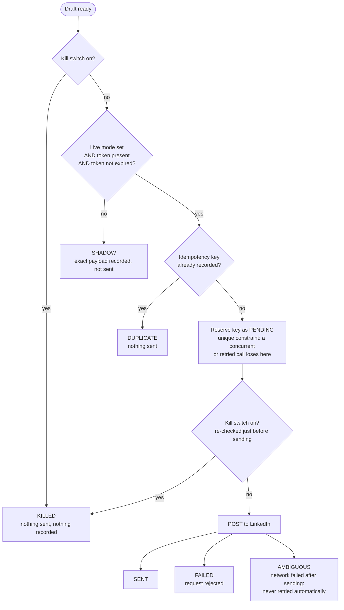
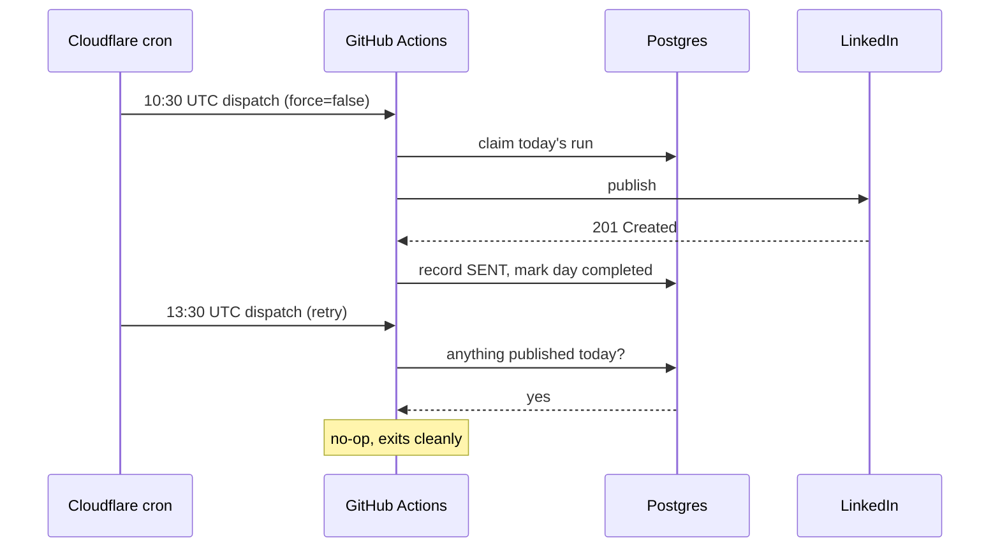

# 3. Reliability engineering

**Triggers can fire more than once, runs can die halfway and providers can fail silently, yet the system must publish exactly one post a day and never two. Reliability comes from designing every step so that repeating it is harmless.**

## The publish path

Every publish attempt goes through the same ordered checks. Each one can stop the attempt.

**Why AMBIGUOUS exists:** if the connection drops after the request may have reached LinkedIn, retrying could post twice. The attempt is recorded as ambiguous and left for a human to check.

**How the idempotency key works:** a hash of the channel, the day and the draft text. The same draft can never be sent twice. A separate per-day guard stops a *different* draft from going out on the same day, because a regenerated draft has different text and therefore a different key.

## Layers of protection against double posts

| Layer | Protects against |
|---|---|
| Workflow concurrency group | Two runs at the same time |
| Daily run lock (one row per UTC day: running, completed or failed) | A finished day being run again by a scheduled trigger |
| "Retry only if unpublished" | Afternoon retries doing anything once a post is live |
| Per-day publication guard | A regenerated draft being posted on the same day |
| Idempotency key with a unique constraint | The same draft being sent twice, even concurrently |
| AMBIGUOUS state | An automatic retry after an uncertain send |

The owner can still deliberately post again: a manual run sets `force`, which lifts the per-day guards but never the idempotency key.

## Self-healing schedule

This was observed in production on 2026-10-12: the 10:30 run published, and the 13:30 retry correctly skipped.

## Handling provider failures

| Failure | Response |
|---|---|
| Writer model's daily token quota used up | Fall back to a smaller model from the same family |
| Search API returns fewer results than asked | Cap requests at the measured limit; treat "no news" as a signal to investigate, not a normal day |
| Reasoning model spends its whole token budget thinking | Lower reasoning effort for extraction tasks; a run that returns nothing is caught |
| Model rejects a parameter (HTTP 400) | Send the parameter only to models known to accept it |
| Budget cap reached, or spend unreadable | Refuse the model call (fail closed); the day is skipped safely and alerted |
| LinkedIn token near expiry | Warn 7 days ahead; once expired, fall back to shadow instead of failing |
| A whole run never starts | A separate watchdog checks every morning that the day's run happened |

## Configuration that cannot break the system silently

Two early outages came from configuration, not code: an empty value copied from the template, and a workflow input that rendered as an empty string on scheduled runs. Both stopped every run, and the alert path failed with them, because it needed the same configuration to start. The fix: empty values are treated as "unset" when settings load, and a test proves the committed template always loads.

## Observability must never fail a run

Every telemetry export swallows its own errors. Losing a trace is acceptable; losing a post because the tracing backend was down is not.
