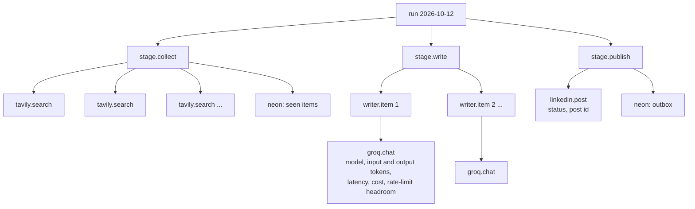

# 4. Observability

**Every run is one trace, every external call is one span, and every dashboard is defined in code. Telemetry follows the OpenTelemetry standard, so the backend can be changed without changing the system.**

## Four questions, four layers

No single tool answers all four questions, so each has its own layer.

| Layer | Question it answers | Implementation |
|---|---|---|
| Traces | What happened inside this run? | OpenTelemetry spans exported over OTLP/HTTP to Langfuse |
| Logs | What did each tool do? | One structured log line per external call, on a per-tool logger |
| Metrics and history | What is the trend? | Postgres ledger tables (runs, usage, billing) plus dashboards |
| Liveness | Did the run happen at all? | A daily watchdog job, independent of the run itself |

## A run as one trace



Every call to an outside system goes through one wrapper that produces both a child span and a log line like:

```text
TOOL tool=groq op=chat run=2026-10-11 status=ok ms=812 model=openai/gpt-oss-120b input_tokens=941 output_tokens=233 ratelimit_remaining_tokens=7059
```

So "show me only the model calls" or "only LinkedIn" is a filter, not a search.

## Standards, not vendor lock-in

- Model calls are tagged with **OpenTelemetry's GenAI semantic conventions** (for example `gen_ai.request.model`, `gen_ai.usage.input_tokens`, `gen_ai.usage.output_tokens`), so a conformant backend shows them as LLM generations without custom mapping. These conventions are still evolving, so attribute names are kept in one place.
- Facts the standard doesn't cover (cost, model tier, run id, outcome) go under a project prefix that can't collide with future standard attributes.
- The backend is a URL plus a header. Moving from Langfuse to another OTLP backend is a configuration change.
- Runs are tagged by environment, so local test runs never pollute production dashboards.

## Dashboards as code

Six dashboards are defined in a script and applied through the Langfuse API, so they are versioned, reviewable and reproducible:

| Dashboard | Shows |
|---|---|
| Overview | Runs, outcomes, spend and latency at a glance |
| Writer (LLM) | Calls, errors, latency including rate-limit waits, tokens, spend, which model served (primary or fallback) |
| News search | Search volume, errors, latency |
| LinkedIn publishing | Publish attempts and outcomes |
| Alerts | Alert issues opened |
| Billing and quotas | Month-to-date bill per vendor, spend per day, free-tier usage trend |

A backfill script loaded runs from before tracing existed, so history starts at the first run, not at the day observability was switched on.

## Alerts

Alerts open GitHub issues assigned to the owner, so there is no email server to run. Each condition has an incident key, and an alert is not reopened while an issue with the same key is open.

| Condition | Scope |
|---|---|
| Run failed | Per day |
| Skipped for an operational reason (a provider failed) | Per day |
| Skipped for quality (a draft didn't meet the bar, exit code 0) | Per day |
| Daily or monthly budget at 80% | Per day / per month |
| LinkedIn token has 7 days or fewer left | Per token |
| Post published, or publish failed | Per run |

A quality skip deserves its own alert: the run "succeeded" (exit code 0), yet nothing was posted. Without this alert, nothing would report it.

## The watchdog

A separate scheduled job checks every morning whether the day's run happened. It catches what the run itself can't report: a trigger that never fired, or a runner that died before writing anything.
