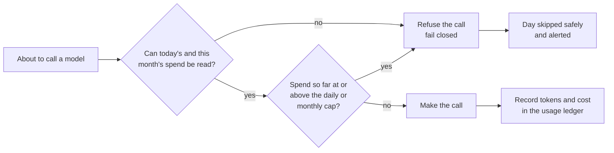

# 5. Cost engineering

**The system runs on a $10/month hard budget with a $1/day cap, enforced in code before every model call. Every call is logged with its tokens and cost, and every vendor's bill is collected automatically each day. First month to date: $0.65 billed.**

## Budget guard: caps in code, not on a dashboard

| Setting | Value | Behaviour |
|---|---|---|
| Monthly cap | $10 | No model call once month-to-date spend reaches it |
| Daily cap | $1 | No model call once today's spend reaches it |
| Alerts | 80% of either cap | A GitHub issue before the cap is hit |
| Unreadable spend | — | Treated as over budget: the call is refused |

A single call can overshoot a cap by its own cost, because cost is only known afterwards. The guard checks spend *before* each call, so the overshoot is bounded by one call.

## Choosing models for cost

| Role | Choice | Cost reasoning |
|---|---|---|
| Writer | An open-weight 120B model on a fast inference provider's free tier | Strong output at near-zero cost |
| Writer fallback | The same family's 20B model | Used when the 120B daily token quota runs out |
| Judge (optional "full" mode only) | A model from a different family than the writer | Judges tend to favour text from their own family |
| Quality checks in the default mode | Plain code | Zero model spend |

**Parameter tuning saved more than model choice.** For a reasoning model, "reasoning effort" was the biggest lever: on one item, completion tokens fell from 159 at the default effort to 36 at low. At the default, one article made the model reason through its entire 16,000-token budget and return nothing.

## Every call on a ledger

Each model call is recorded with the pipeline, stage, model, input and output tokens, cost, latency, outcome and the day's run id. A token count the provider didn't report is stored as *unknown* (NULL), never as zero, so missing data can't masquerade as free usage.

## Collecting every vendor's bill

A daily job collects the month-to-date bill and free-tier usage for each vendor and appends it to an append-only table, which feeds the billing dashboard.

| Vendor | Source of the figure |
|---|---|
| CI and source hosting, search API, database, scheduler, observability | The vendor's own billing or usage API |
| Writer model provider, judge model provider | The system's own ledger (no billing API available for this account type) |
| LinkedIn | Plan (no charge for this API use) |

Design details that keep the numbers honest:

- **Append-only snapshots.** A day's spend is the difference between two snapshots in the same month, so history is never rewritten.
- **Daily spend, not month-to-date, goes to the dashboard.** A dashboard sums over the chosen date range; summing month-to-date figures over a week would count Monday seven times.
- **A missing bill is a finding.** If any vendor can't be read, the job fails and the owner is notified, instead of quietly reporting a lower total.

## Keeping storage cheap

Postgres holds only what SQL needs to answer (scores, counts, outcomes, about 100 bytes a day). Full draft text, judge reasoning and source excerpts go to one markdown file per day in git, which versions, diffs and renders them for free. On the database's free tier, running out of storage blocks writes rather than adding a charge.

## Measured spend

| Period | Billed | At list price | Notes |
|---|---|---|---|
| October 2026, to 2026-10-12 | $0.65 | $4.33 | Almost all from the optional LLM judge, used 6–9 October and then switched off |

A full month of the default mode is still being measured before a cost-per-post figure is published.
