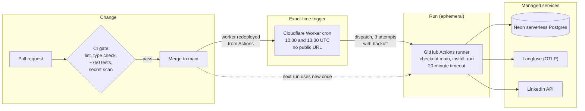

# 6. Deployment

**There are no servers. A Cloudflare Worker fires at the exact minute, a fresh GitHub Actions runner builds from `main` and runs the workflow, and managed services hold state and telemetry. Merging to `main` is the release; `git revert` is the rollback.**

## Deployment architecture

## Components

| Component | Runs on | How it is deployed |
|---|---|---|
| The workflow | GitHub Actions, a fresh Ubuntu VM per run | No deploy step: every run checks out `main` and installs it |
| The scheduler | Cloudflare Worker cron | Redeployed by a workflow when its files change; no local tooling |
| Database | Neon serverless Postgres | Managed; the schema is created and extended by the code, idempotently |
| Telemetry | Langfuse Cloud via OpenTelemetry | Managed; dashboards applied from code |
| Daily side jobs | GitHub Actions | Watchdog (did today's run happen?) and billing collection |

## Why an exact-time trigger

GitHub's own scheduled workflows were measured starting **3.7 to 6 hours late**, and on 2026-10-11 one **never ran**. A daily post that lands at a random hour, or not at all, defeats the purpose.

The fix is a Cloudflare Worker on a cron schedule that calls GitHub's API to start the workflow at the exact minute:

- **Retries with backoff** on server errors and rate limits; a permission error stops immediately and fails loudly, because retrying cannot fix it.
- **One structured log line per attempt**, in the same shape as the workflow's tool logs.
- **No public URL**, so nothing on the internet can trigger it.
- **A narrowly scoped token**: it can only start workflows on this one repository, and lives as an encrypted Cloudflare secret.
- **Layered triggers:** the Worker at 10:30, a retry at 13:30, and GitHub's own schedule as a backup. All are safe to fire because a later run is a no-op once the day has published.

## Release safety without a staging server

| Mechanism | What it gives |
|---|---|
| CI gate on every pull request | Nothing reaches `main` without passing lint, types, tests and a secret scan |
| Shadow mode | The full workflow runs, but the exact LinkedIn payload is recorded instead of sent. Used before go-live and for every new version |
| Safe default | Live only if live mode is set **and** a token is present **and** it hasn't expired; anything else means shadow |
| Kill switch | A single setting that blocks publishing, checked at the start and again right before the API call |
| Rollback | `git revert`; the next run uses the previous code |
| Concurrency group and run lock | No two runs at once; a finished day isn't re-run |
| Timeouts | 20 minutes per run, so a hung run can't burn compute |

### Shadow mode vs kill switch

| | Shadow mode | Kill switch |
|---|---|---|
| Purpose | Testing: "show me what you would post" | Emergency: "stop posting now" |
| Pipeline runs | Fully | Yes, but publishing is blocked |
| Payload recorded | Yes | No |
| Scope | The non-live mode | Overrides every mode |

## Trade-offs

- **Not always on.** No webhooks or interactive approval page. If one is needed, a container service (for example Cloud Run) is the planned next step.
- **Dependencies install on every run.** About a minute of overhead, irrelevant for a once-a-day job.
- **Free-tier limits.** CI minutes, database storage and telemetry quotas are tracked by the billing job.
