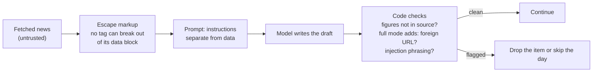
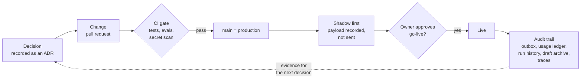

# 7. Security and governance

**The system reads untrusted web content, holds live credentials and posts under a real person's name. Each risk has a control in code, and every decision that changes behaviour is recorded, reviewed and reversible.**

## Threats and controls

| Threat | Control |
|---|---|
| Secrets committed to the repository | Local env files are ignored by git; the committed template holds names only; every push and pull request is scanned by gitleaks |
| Secrets printed into a log or an AI assistant's transcript | A pre-execution hook blocks commands that would print a credential file, and fails closed on unparseable input |
| Prompt injection from fetched news | All fetched text is escaped before it enters a prompt, so no tag can be opened or closed from inside a data block |
| Injected instructions taking effect | Default mode: every figure must appear in its own source, and links are rendered from the source list, not written by the model. Full mode adds deterministic checks that flag a URL that isn't a source, or phrasings like "ignore previous instructions" |
| Invented first-person claims in the owner's name | First-person experience is allowed only when the owner has attested it in an evidence register (only the owner adds entries); an empty register means no first-person claims at all |
| A post going out by accident | Shadow by default, kill switch, idempotent publishing ([chapter 3](03-reliability.md)) |
| Runaway spend from a bug or a loop | Hard daily and monthly caps, failing closed ([chapter 5](05-cost-engineering.md)) |
| Scheduler abuse | The trigger has no public URL; its token can only start workflows on one repository |

## Prompt-injection defence in depth

The escaping covers `&` as well as `<` and `>`, so an already-escaped sequence in the input can't be confused with real markup.

## Why the hook exists

On 2026-10-06, a command printed a local credential file into an AI-assistant session and four live credentials had to be rotated. A written rule had not prevented it. The hook does, because the tool harness enforces it. Its own history is instructive: an early version silently allowed everything because a dependency was missing, and another blocked everything because it never received its input. The current version is a plain script with its own tests.

## Governance

Security answers "can it be attacked?". Governance answers "who decided what, can we prove what happened, and can we undo it?".

| Principle | How it is implemented |
|---|---|
| **Decisions are recorded** | Eight Architecture Decision Records so far: why the repo is standalone, how runs are triggered, the writer model tiers, shadow mode until explicit go-live, the attestation stage, OpenTelemetry, light mode, exact-time triggers. Each states its context, the decision and what it supersedes |
| **A human owns the risky switches** | Going live, adding first-person evidence, changing the budget and re-authorising LinkedIn are owner actions. The system can't turn itself live |
| **Changes are reviewed and gated** | Every change goes through a pull request and CI (tests, the seeded eval, secret scan). Changing the judge prompt or model fails CI until a live eval re-approves it |
| **Prompts and voice are versioned** | The voice guide carries a version, and every draft records the version that produced it. Judge recordings store the prompt hash and model id |
| **Everything is auditable** | The publications outbox (every attempt and its outcome), the usage ledger (every model call, tokens and cost), the daily run history, one archived markdown record per day with the draft and reasons, and a trace per run |
| **Everything is reversible** | Behaviour changes by configuration, not deletion: light and full mode, shadow and live, the kill switch. Code rolls back with `git revert` |
| **Least privilege** | Each credential does one job: the trigger token can only start workflows on one repository; workflow permissions are limited to what each job needs (for example, writing the run history and opening alert issues) |
| **Spend is governed by policy in code** | Daily and monthly caps, alerts at 80%, and fail-closed behaviour ([chapter 5](05-cost-engineering.md)) |
| **Data minimisation** | Postgres keeps outcomes, counts and the text that was actually published; full drafts, judge reasoning and source excerpts live in git. No reader or follower data is collected |
| **Platform rules are respected** | Official API only, no automation of engagement ([below](#platform-compliance)) |

## Platform compliance

The system stays inside LinkedIn's rules by design:

- **Publishes only through the official API**, as the account owner, with the self-serve "Share on LinkedIn" product.
- **No browser automation, scraping or engagement automation.** LinkedIn prohibits bots and extensions that scrape or automate activity, and in March 2026 said it targets comment automation and engagement pods ([references](references.md)).
- **Respects the 60-day token lifetime.** Refresh tokens are only available to approved partners, so the owner re-authorises by hand. The system warns 7 days ahead and falls back to shadow once the token expires.
- **Rate limits** (150 requests per member per day for this product) are far above one post a day.

## AI disclosure

LinkedIn's Content Credentials labels cover images and video with signed C2PA metadata; its documentation doesn't address AI-written text. Disclosure of AI assistance in text posts is therefore the owner's decision. Requirements may differ by jurisdiction.
