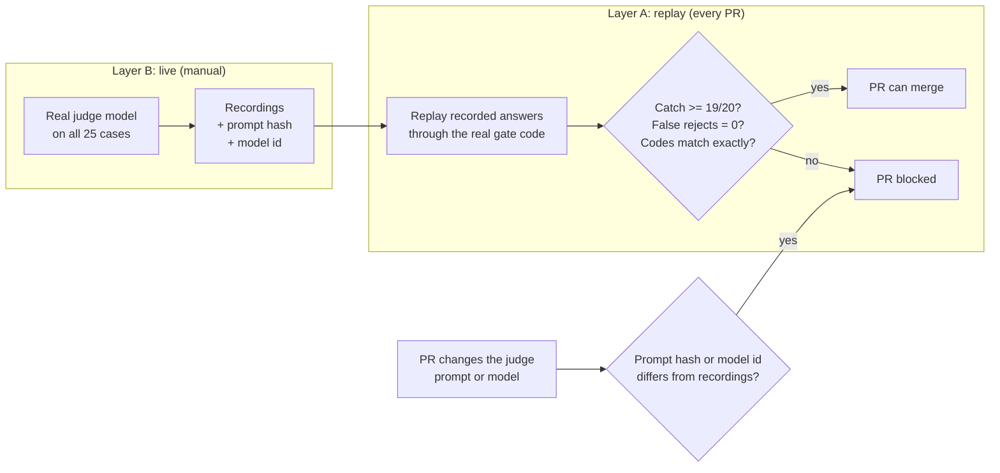

# 8. Evaluation

**The fact-checker is evaluated by fault injection: 20 drafts each carry one deliberately planted error, and 5 correct drafts are designed to tempt false alarms. The target is at least 19 of 20 caught, with every catch tied to the exact characters that were changed. CI replays recorded model answers, so the eval runs on every pull request at no cost.**

## What is being measured

| Metric | Question | Target |
|---|---|---|
| Catch rate | Of the drafts with a planted error, how many were rejected for the right reason, at the right place? | At least 19 of 20 (95%) |
| False-reject rate | Of the correct drafts, how many were wrongly blocked? | 0 of 5 |

Both matter. A checker that rejects everything has a perfect catch rate and is useless.

## How the cases are built

1. **Sources about fictional companies** ("Kestrel Labs", "Orrin-7"). With fictional entities the checker cannot use its own world knowledge; it must compare the draft with the sources, which is exactly the behaviour under test.
2. **A correct draft** written from those sources.
3. **Exactly one mutation**, with the changed span and its character offsets recorded. One defect per case keeps attribution unambiguous.
4. **Hard variants:** at least 5 cases use a single-digit change, a distractor entity that really is in the sources, or certainty inflated by deleting one word.

| Planted error | Example | Cases |
|---|---|---|
| Number altered | "38%" becomes "58%" | 3 |
| Entity swapped | Another company from the same sources gets the credit | 3 |
| Date shifted | A release window or version changed | 2 |
| Certainty inflated | "reportedly plans to" becomes "has" | 3 |
| Negation flipped | "does not support" becomes "supports" | 2 |
| Fact fabricated | "and it's open-weights" added from nowhere | 3 |
| Items conflated | Item 2's fact attributed to item 1's subject | 2 |
| First person fabricated | "we cut our bill 40% switching to this" | 2 |

The **5 controls** are correct drafts built to provoke false alarms: plain, labelled speculation, opinion-heavy, heavily paraphrased, and a hedged rounded number ("about 40%" where the source says 39.6%).

## What counts as a catch

A planted error is caught only if **all three** hold:

1. The draft is rejected.
2. It is rejected with an expected reason code (for example "contradicted claim").
3. A failing claim **overlaps the exact characters that were changed**.

Rule 3 stops lucky catches: a draft rejected for an unrelated reason doesn't inflate the score.

## Running it in CI without model calls

- **Layer A (every pull request, free, deterministic):** recorded judge answers are replayed through the real parsing, evidence checks, deterministic rules and scoring. Any code change that weakens the checker blocks the merge.
- **Regression guard:** each recording stores the prompt version, prompt hash and model id. Changing the judge prompt or model fails CI until a fresh live run passes and its recordings are committed.
- **Layer B (manual, live):** runs the real model and refreshes the recordings. Designed; not yet wired into a workflow.
- **Backstop report:** the eval also reports how much the code-only rules catch with no model at all, which shows what the model actually adds.

## Golden post: anchoring to a human standard

- A real, excellent published post must **pass** every rubric dimension. If the gate rejects it, the gate is wrong.
- A known bad post must be rejected on voice and spam.
- The judge's answers for both are recorded from a real model, not hand-written, and a changed rubric prompt fails loudly instead of serving stale answers.

## What the eval did not predict

In production, the strict gate caught real embellishments on four consecutive days, and blocked every post that week. Part of the cause was bugs in the checks themselves (a URL slug read as copying, a curly apostrophe read as an invented quote). An offline catch rate says nothing about false rejections on *real* drafts, so that is now tracked as a first-class metric.

## Gaps and next evals

| Gap | Plan |
|---|---|
| The eval covers the optional judge, not the default light mode | Replay real light-mode drafts through a narrow fact critic (numbers, names, attributions only) |
| No measure of de-duplication or coverage | Label a few weeks of collected news: repeats missed, follow-ups wrongly dropped, major launches missed |
| No judge-human agreement figure | Compare judge verdicts with the owner's own ratings (Cohen's kappa) |
| No audience outcome | Depends on post-analytics API access |
