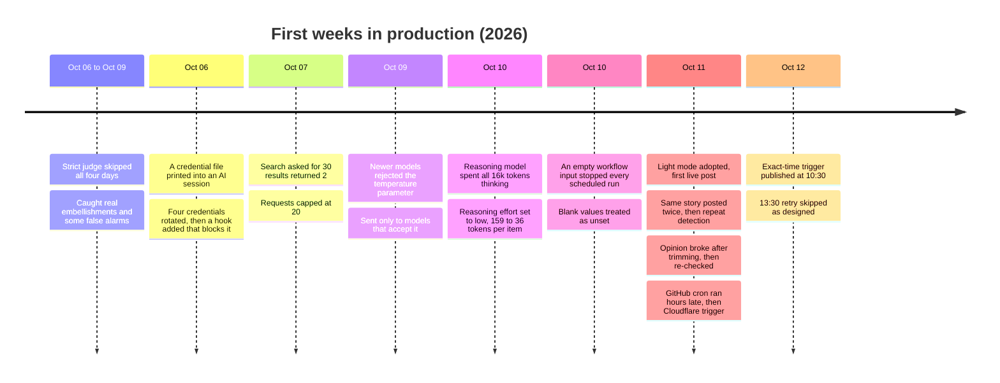

# 9. Results and lessons learned

**In its first weeks the system taught more through failures than successes. Most fixes came from a provider or platform behaving differently from its documentation, not from model quality.**

## Results (as of 2026-10-12)

| Measure | Result |
|---|---|
| Daily posts after the switch to light mode | Published on 11 and 12 October, after a week with none |
| Exact-time trigger | Fired at 10:30:12 UTC on 2026-10-12; the 13:30 retry correctly skipped |
| Billed spend, first month to date | $0.65 ($4.33 at list price), mostly from the optional judge used 6–9 October |
| Run cost estimate, full mode vs light mode | $0.04–$0.41 per run vs about $0.004 per run (ledger estimate, placeholder pricing) |
| Automated tests | About 750 |
| Seeded fact-check eval | 25 cases; CI enforces at least 19 of 20 caught with no false rejects |

## Timeline of incidents and fixes

## What the strict judge caught (6–9 October)

| Day | Reason the post was skipped |
|---|---|
| 09 Oct | A funding detail (who led a round) not attributable to any source |
| 08 Oct | A benchmark comparison not supported by any source excerpt |
| 07 Oct | A market-size figure not attributable to the sources |
| 06 Oct | A price per million tokens not supported by any source excerpt |

Replaying these refusals found three kinds of cause: real writer embellishment, bugs in the checks themselves, and provider limits. Light mode removed the false alarms *and* the real catches. The planned fix is a narrow critic that checks only numbers, names and attributions.

## Lessons

1. **Silent degradation is the most common failure.** The search API returned fewer results without an error; the reasoning model returned an empty answer without failing. Every stage must check what it actually received, not just whether the call succeeded.
2. **Measure providers directly.** Documentation did not predict the search cap, the parameter rejection or the scheduler drift. Each was found by measuring, and each measurement is recorded next to the setting it justifies.
3. **Strictness has a cost.** A gate that blocks every day is as much a failure as no gate. Track false rejections on real drafts, not just catch rate on test cases.
4. **Fail safe, and make failure visible.** Every uncertain state means "don't publish", and a run that publishes nothing still raises an alert, even when its exit code is 0.
5. **Written rules don't stop mistakes; enforced ones do.** The credential leak happened despite a written rule; the hook made it impossible.
6. **Configuration is code.** Two outages came from empty configuration values. Blank-means-unset handling and a test that loads the committed template closed both.
7. **Keep every decision reversible.** Light mode didn't delete the full gate; going back is one setting. That made a big change cheap to try.
8. **Don't trust a scheduler you don't control.** A daily product needs an exact-time trigger, layered retries and a guard that makes extra triggers harmless.
