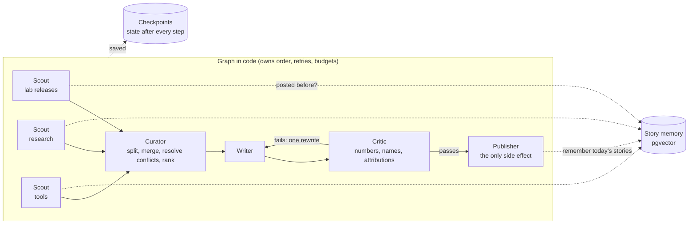

# 10. Future work: the agentic version

**The next version gives models control over parts of the flow: scouts choose their own searches, a curator resolves conflicting sources, and a critic can send a draft back. It will run in shadow mode next to the current workflow and has to prove it is better per dollar before it publishes.**

## Why move beyond a workflow

Running the workflow daily exposed problems that need judgment rather than more rules:

| Problem seen in production | Why rules struggle | Agentic answer |
|---|---|---|
| The same story under a reworded headline | Title similarity misses paraphrases | Semantic memory: compare meaning, not words |
| A roundup article covering three launches became one item | No rule knows how to split prose | A curator that splits roundups into stories |
| Sources disagree on a number or date | Code can't judge which source to trust | A curator applying source precedence (official announcement over press, newest over oldest) |
| Writer embellishments in light mode | The strict judge blocked too much | A narrow critic with a bounded rewrite loop |

## Planned architecture

## Key design choices

| Choice | Decision | Reason |
|---|---|---|
| Orchestration | A graph in code, with model judgment inside the agents (hybrid) | Code guarantees order and hard rules ("nothing publishes without the critic passing"); models add judgment where it pays |
| Communication | Agents never call each other; they read and write a shared, typed state | Every hand-off can be logged, saved and replayed |
| Parallel scouts | Results merge by appending, never overwriting | Three scouts can run at once safely |
| Persistence | State checkpointed to Postgres after every step | A crashed run resumes instead of restarting; any run can be replayed |
| History check | Scouts query semantic memory before passing items on | Old news is dropped at the source, before it costs tokens downstream |
| Embeddings | A small open model (384 dimensions) running on CPU in CI | Free, no new vendor |
| Failure handling | Per-agent retries and timeouts, model fallback on quota, schema validation, graceful degradation (continue with 2 of 3 scouts), safe skip and alert | Each failure type gets its own response |
| Model parameters per agent | Deterministic curator and critic; some variety for the writer | Judgments should be repeatable; posts shouldn't all sound the same |

## How it will be judged

The agentic version runs in **shadow mode** on the same days' news as the workflow, with its own quotas so it can't starve the daily post. The comparison:

| Measure | Workflow | Agentic |
|---|---|---|
| Repeats caught across days | Title similarity | Semantic memory |
| Major launches covered vs missed | Measured against each day's frontier-lab announcements | Same |
| Unsupported claims reaching the post | Measured by replaying drafts through the critic | Same |
| Steps, latency and cost per run | From traces | From traces |
| Failure behaviour | Fault injection: kill a scout, time out the search, exhaust a quota | Same |

It goes live only if it is measurably better per dollar.
